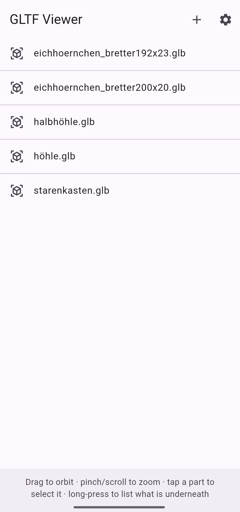
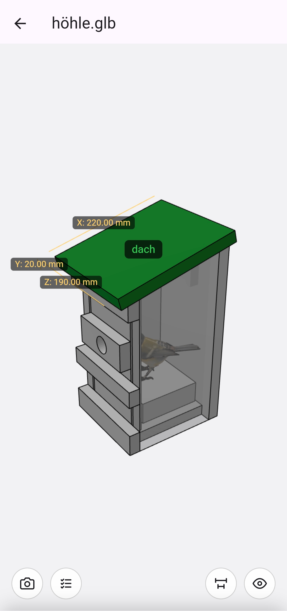
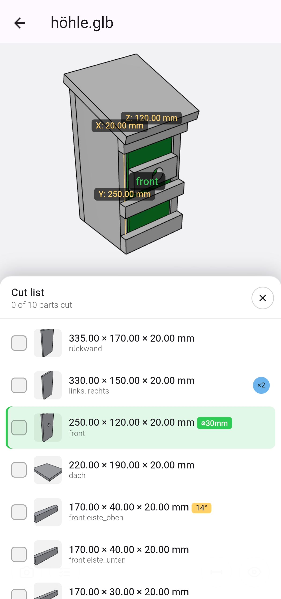

# GLTF Viewer

A simple, offline Android viewer for 3D models in the glTF format (`.glb` / `.gltf`).

I built this small viewer for myself and am publishing it in case someone else needs something similar.
It has no ads, no tracking and no accounts, and it never sends your files anywhere.

<p>
  
  
  
</p>

## Features

**Opening models**
- Choose a folder on your device, and every `.glb` / `.gltf` file in it is listed on the home screen. The app remembers the folder between launches.
- Or open any single file directly.

**3D view** (built on [three.js](https://threejs.org))
- Drag to orbit, and pinch or scroll to zoom.
- Parts are drawn with outlines, so edges and creases stay readable.
- Tap a part to select it. The selected part is highlighted, and its name and X/Y/Z dimensions are shown.
- Tapered or angled parts also show the length of their short edge. You can turn this off.
- Long-press to list every part under your finger, which lets you pick parts that are hidden behind others.
- Make the selected part see-through to look behind or inside it. Several parts can stay see-through at the same time.
- If the file contains a camera, switch to it to see the model exactly as it was framed in your 3D software, then switch back to the free view.

**Cut list**
- Shows all parts of the model grouped by their size, with how many of each you need and the diameter of any drilled holes. This is handy for woodworking and similar projects.
- Tap an entry to highlight those parts in the 3D view.
- Mark entries as done. Your progress is saved per model.

**General**
- Four themes: light, dark, light pastel and dark pastel. The theme applies to the 3D view as well.
- English and German. The app follows your device language and can be switched in Settings.
- Works completely offline. The 3D engine is bundled with the app, and nothing is downloaded while it runs.

> **Note on units:** measurements are shown in millimeters, and the app treats **1 glTF unit as 1 mm**. This fits models built at millimeter scale and exported without unit conversion, for example from Blender. Strictly by the glTF spec, 1 unit is 1 meter, so models that follow it will show values 1000× too small.

## Privacy and permissions

The app does not collect, store or send any data apart from your own settings, which stay on the device.

It requests the `INTERNET` permission for a technical reason only. The 3D view runs in a WebView and loads the model you chose from a small web server that the app starts **inside itself**, reachable only at `127.0.0.1`. Plain-HTTP traffic is allowed for that loopback address only (see [network_security_config.xml](android/app/src/main/res/xml/network_security_config.xml)), and the app never connects to the internet.

## Installing

- **F-Droid:** submission in progress.
- **Build it yourself:** see below.

## Building from source

Requirements:
- [Flutter](https://docs.flutter.dev/get-started/install) 3.44 or newer (stable channel)
- Android SDK / Android Studio with a JDK 17

```sh
git clone https://github.com/kammarc/gltfViewerDroid.git
cd gltfViewerDroid
flutter pub get
flutter run                      # debug build on a connected device
flutter build apk --release      # release APK in build/app/outputs/flutter-apk/
```

Release signing is optional. If `android/key.properties` exists, the release APK is signed with the keystore it points to. Otherwise the APK is built unsigned.

```properties
storePassword=...
keyPassword=...
keyAlias=...
storeFile=/path/to/upload-keystore.jks
```

The app also runs in a web browser (`flutter run -d chrome`), which is mainly useful for development.

## Project layout

| Path | Contents |
| --- | --- |
| `lib/` | Flutter app: screens, folder access, settings, translations |
| `assets/three_viewer/` | The 3D viewer (`index.html`, `viewer.js`) shown in the WebView |
| `assets/three_viewer/vendor/three/` | Bundled copy of three.js (MIT license) |
| `android/` | Android project, including the Storage Access Framework folder access in `MainActivity.kt` |
| `fastlane/metadata/` | Store listing (descriptions, screenshots, changelogs) used by F-Droid |

## Contributing

Bug reports, feature ideas and pull requests are welcome. Please use the [issue tracker](https://github.com/kammarc/gltfViewerDroid/issues).
New translations are easy to add. All strings are in [lib/l10n/strings.dart](lib/l10n/strings.dart) and at the top of [assets/three_viewer/viewer.js](assets/three_viewer/viewer.js).

## Built with AI assistance

This project was written to a large extent by **Claude**, an AI model by Anthropic, used as a coding
assistant (Claude Code). That covers architecture, backend and frontend code, the item catalog, the
tests and this documentation. The project owner defined the requirements and made the product and
design decisions. Please review and test it like any other third-party code before relying on it,
and report issues.

## License

This project is licensed under the [MIT License](LICENSE). You may use, copy, modify, merge, publish, distribute, sublicense and sell it, as long as the copyright notice and the license text are included.

Third-party components:
- [three.js](https://github.com/mrdoob/three.js), © three.js authors, [MIT License](assets/three_viewer/vendor/three/LICENSE)
- Flutter and the Dart packages listed in [pubspec.yaml](pubspec.yaml), each under its own open source license (BSD-3-Clause, MIT or Apache-2.0).
